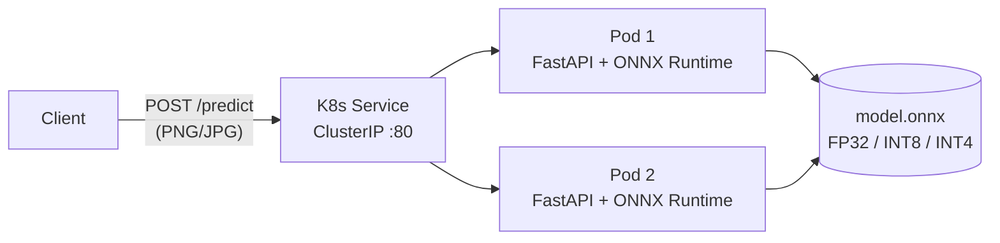

# MNIST Edge-AI Inference Service

**A quantized CNN served as a production-style microservice: ONNX Runtime + FastAPI, containerized with Docker, deployed on Kubernetes (k3s/k3d).**


Built for the *Machine Learning in Embedded Systems (EML)* course at RPTU Kaiserslautern-Landau, this project covers the path from a trained model to a deployable edge service. A PyTorch CNN is exported to ONNX and quantized to **8-bit and 4-bit** weights with Brevitas. It is served behind a REST API and runs as a resource-limited, horizontally scaled Kubernetes workload.

---

## Highlights

- **3.8× smaller model:** quantization cuts the model from 478 KB to 126 KB with about 1 percentage point of accuracy loss.
- **Sub-millisecond inference:** 0.07 ms median per image for FP32 on a laptop CPU.
- **One image, any model:** the model file and version are Docker build arguments and environment variables, so FP32, INT8 and INT4 variants ship from one codebase.
- **Edge-sized footprint:** each pod is limited to 0.5 vCPU and 256 MiB RAM, and runs 2 replicas behind a ClusterIP Service with liveness and readiness probes.
- **Measured, not assumed:** the benchmark script separates *model compute time* from *end-to-end HTTP latency*, with warm-up runs and P95 reporting.

## Results

Evaluated on the full **MNIST test set (10,000 images)**, batch size 1, ONNX Runtime 1.29 `CPUExecutionProvider`, Intel Core i5-10300H.

| Model | Weights | File size | Test accuracy | Median latency | P95 latency |
|---|---|---:|---:|---:|---:|
| `Baseline.onnx` | FP32 | 478.4 KB | **97.85 %** | **0.072 ms** | 0.086 ms |
| `Quant_8bit.onnx` | INT8 (range ±127) | **125.9 KB** | 96.76 % | 0.142 ms | 0.175 ms |
| `Quant_4bit.onnx` | INT4 (range ±7, 15 levels) | **125.9 KB** | 96.92 % | 0.136 ms | 0.173 ms |

**Serving latency** (FastAPI + Uvicorn, 10 warm-up and 100 measured requests, `benchmark_k3s.py`):

| Metric | Mean | Median | P95 |
|---|---:|---:|---:|
| ONNX inference inside the service | 0.18 ms | 0.17 ms | 0.25 ms |
| End-to-end HTTP request (upload → JSON) | 6.8 ms | 2.8 ms | 24.6 ms |

### What the numbers show

1. **Model compute is a tiny share of request latency.** The CNN runs in under 0.2 ms, but a full HTTP round-trip takes about 2.8 ms. Multipart parsing, image decoding and networking take up most of the time. A faster model would barely help; batching or a binary protocol (e.g. gRPC) would help more.
2. **Quantization saves memory and storage, not CPU time, in this format.** The quantized models use the QCDQ export pattern (`int8 weights → Clip → DequantizeLinear → float Conv/Gemm`). That cuts storage by 3.8×, but weights are dequantized to float at runtime, so a desktop CPU runs them about 2× slower than FP32. A real speed-up needs an integer-only path (QOperator / `QLinearConv`) or hardware with INT8 kernels (NPU, MCU, FPGA).
3. **4-bit costs no more accuracy than 8-bit, and both files are the same size.** ONNX has no packed 4-bit storage here, so the 4-bit weights sit in int8 containers. The accuracy result shows the model tolerates aggressive quantization well. With bit-packing, the 4-bit model would be about 8× smaller than FP32.

## Architecture



**Request pipeline inside a pod:**

```
image upload → grayscale → resize 28×28 → scale to [0,1] → normalize (μ=0.1307, σ=0.3081)
            → tensor [1,1,28,28] → ONNX Runtime → logits [1,10] → softmax → {prediction, confidence}
```

**Model:** a compact CNN with about 122k parameters.

```
Conv(1→32, 3×3) → ReLU → MaxPool
Conv(32→64, 3×3) → ReLU → MaxPool
Flatten(1600) → Linear(1600→64) → ReLU → Linear(64→10)
```

## API

| Method | Endpoint | Description |
|---|---|---|
| `GET` | `/health` | Liveness and readiness check; returns status, model version and execution provider |
| `GET` | `/model` | Model metadata: input/output names, shapes and types |
| `POST` | `/predict` | Classify an uploaded digit image |
| `GET` | `/docs` | Interactive Swagger UI (generated by FastAPI) |

```bash
curl -F "file=@test_digit.png;type=image/png" http://127.0.0.1:8080/predict
```

```json
{
  "prediction": 7,
  "confidence": 0.999959,
  "latency_ms": 0.167,
  "model_version": "baseline-fp32-v1",
  "model_file": "Baseline.onnx"
}
```

Non-image uploads and corrupt files are rejected with `400 Bad Request`.

## Quick start

### 1. Run locally

```bash
python -m venv .venv
source .venv/bin/activate          # Windows: .venv\Scripts\activate
pip install -r requirements.txt

uvicorn app:app --host 0.0.0.0 --port 8080
# open http://127.0.0.1:8080/docs
```

Serve a different model through environment variables:

```bash
MODEL_PATH=models/Quant_8bit.onnx MODEL_VERSION=quant-int8-v1 uvicorn app:app --port 8080
```

### 2. Run in Docker

```bash
# FP32 baseline (default)
docker build -t edge-mnist-inference:v1 .

# INT8 variant from the same Dockerfile
docker build -t edge-mnist-inference:int8 \
  --build-arg MODEL_FILE=Quant_8bit.onnx \
  --build-arg MODEL_VERSION=quant-int8-v1 .

docker run --rm -p 8080:8080 edge-mnist-inference:v1
```

The image is based on `python:3.12-slim` and contains only the runtime dependencies and a single model file. Dev scripts and the dataset are excluded through `.dockerignore`.

### 3. Deploy to Kubernetes (k3s via k3d)

```bash
k3d cluster create edge-ai
k3d image import edge-mnist-inference:v1 -c edge-ai   # load the local image into the cluster

kubectl apply -f deployment-real.yaml
kubectl get pods -l app=mnist-edge-ai                 # 2/2 replicas Running

kubectl port-forward svc/mnist-edge-ai 8082:80
```

### 4. Benchmark

```bash
python benchmark_k3s.py                                         # targets http://localhost:8082/predict
BENCHMARK_URL=http://127.0.0.1:8080/predict python benchmark_k3s.py
```

> **Windows tip:** use `127.0.0.1` instead of `localhost`. `localhost` tries IPv6 (`::1`) first and can add about 2 s to every request.

## Project structure

```
.
├── app.py                 # FastAPI inference service (model loaded once at startup)
├── Dockerfile             # Slim image; model selectable via build args
├── deployment-real.yaml   # K8s Deployment (2 replicas, limits, probes) + Service
├── benchmark_k3s.py       # Latency benchmark: model time vs end-to-end HTTP time
├── models/
│   ├── Baseline.onnx      # FP32
│   ├── Quant_8bit.onnx    # Brevitas INT8 (QCDQ)
│   └── Quant_4bit.onnx    # Brevitas INT4 (QCDQ)
├── inspect_model.py       # Print ONNX inputs/outputs and execution providers
├── predict_local.py       # Offline sanity check without the API (FP32)
├── predict_quant8.py      # Offline sanity check (INT8)
├── export_test_image.py   # Export a sample MNIST digit to test_digit.png
└── requirements.txt       # Pinned runtime dependencies
```

## Tech stack

**ML:** PyTorch, Brevitas (quantization), ONNX, ONNX Runtime, NumPy
**Serving:** FastAPI, Uvicorn, Pillow
**Infrastructure:** Docker, Kubernetes (k3s / k3d), kubectl

## Roadmap

- [ ] Export with the integer-only QOperator format so INT8 is faster on CPU, not only smaller
- [ ] Bit-pack 4-bit weights for a true ~8× size reduction
- [ ] Batch endpoint (`/predict/batch`) to amortize HTTP overhead
- [ ] Prometheus `/metrics` and a HorizontalPodAutoscaler
- [ ] Deploy to ARM edge hardware (Raspberry Pi / Jetson) and compare latency
- [ ] Unit tests and a GitHub Actions CI pipeline (lint, test, image build)

## Author

**Hamza Junaid**, RPTU Kaiserslautern-Landau
